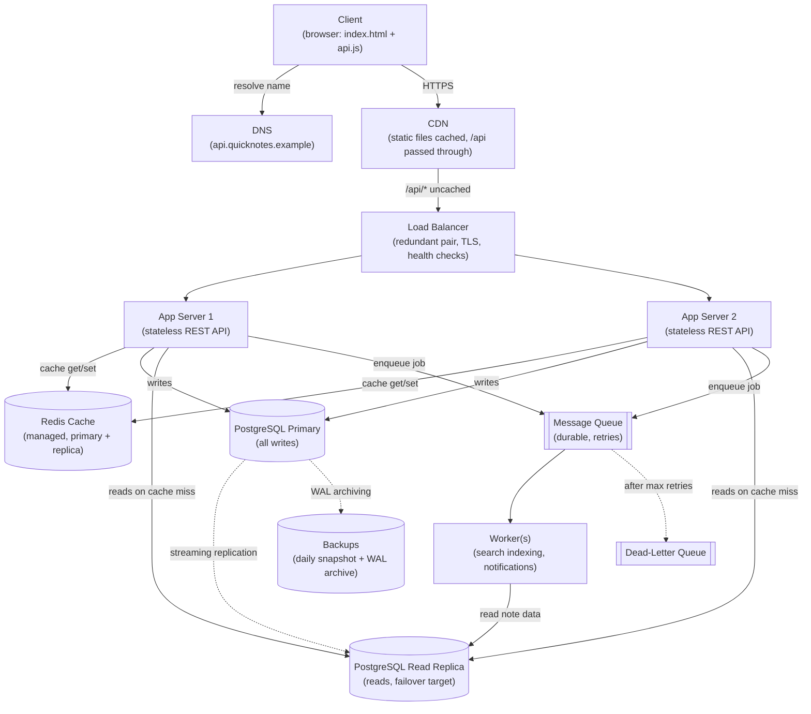

# QuickNotes Architecture

This document describes the system design for moving QuickNotes from a
browser-only app to an online service for **1 million registered users**. It
builds on the [API design](api-design.md) and the [data model](data-model.md).

## 1. Requirements

### Functional requirements

| # | Requirement |
| --- | --- |
| F1 | **Auth:** users can register, log in and receive a token; every notes request is authenticated. |
| F2 | **CRUD notes:** users can create, read, update and delete their own notes (title 1–100 chars, optional body). |
| F3 | **Tags:** users can attach tags to notes and list their tags with note counts. |
| F4 | **List and filter:** users can list their notes newest first, page through them, and filter by tag. |
| F5 | **Privacy:** users can only ever see or change their own notes and tags. |

### Non-functional requirements

| Quality | Target | What it means in practice |
| --- | --- | --- |
| Availability | **99.9%** per month | At most about 43.2 minutes of downtime per month (0.1% × 30 days × 24 h × 60 min). No single point of failure (section 7). |
| Latency | **p95 < 200 ms** server-side for API requests | 95% of requests finish in under 200 ms, measured at the load balancer. Cached reads aim for < 20 ms. |
| Durability | **No acknowledged write is lost** in normal operation; RPO ≤ 1 min, RTO ≤ 15 min after a database failure | A note is saved once the API returns `201`. Continuous WAL archiving plus daily backups (kept 30 days) allow restoring to any point in time. |
| Security | HTTPS only, hashed passwords, JWT auth, per-user data scoping, rate limiting | See [api-design.md §6](api-design.md#6-security-and-operations). |
| Scalability | Handle 5× peak today and grow 10× without a redesign | App servers are stateless and scale out; reads scale with cache and replicas. |

## 2. Load estimate

### Assumptions

| Assumption | Value | Reasoning |
| --- | --- | --- |
| Registered users | 1,000,000 | Given. |
| Daily active users (DAU) | 20% → **200,000** | A typical ratio for a productivity app. |
| Reads per active user per day | 20 | Opening the app, paging, filtering, viewing notes. |
| Writes per active user per day | 5 | Creates, edits, deletes. |
| Peak-to-average ratio | 5× | Traffic clusters around working hours, not spread evenly over 24 h. |
| Average stored note size | ≈ 2 KB | Title + body + tags + metadata + index overhead. |
| Seconds per day | 86,400 | 24 × 60 × 60. |

### Requests per second

| Metric | Arithmetic | Result |
| --- | --- | --- |
| Reads per day | 200,000 users × 20 reads | **4,000,000 reads/day** |
| Average reads/s | 4,000,000 ÷ 86,400 | **≈ 46 reads/s** |
| Peak reads/s | 46.3 × 5 | **≈ 232 reads/s** |
| Writes per day | 200,000 users × 5 writes | **1,000,000 writes/day** |
| Average writes/s | 1,000,000 ÷ 86,400 | **≈ 11.6 writes/s** |
| Peak writes/s | 11.6 × 5 | **≈ 58 writes/s** |
| Total peak | 232 + 58 | **≈ 290 requests/s** |
| Read:write ratio | 4,000,000 : 1,000,000 | **4 : 1**, so the design should favour reads |

### Storage per year

Worst case: every write creates a new note. In reality some writes are edits
and deletes, so this is an upper bound for capacity planning.

| Metric | Arithmetic | Result |
| --- | --- | --- |
| New data per day | 1,000,000 notes × 2 KB | 2,000,000 KB = **≈ 2 GB/day** |
| New data per year | 2 GB × 365 | **≈ 730 GB/year** |
| With one read replica | 730 GB × 2 copies | ≈ 1.46 TB of database disk per year |
| After 3 years (primary) | 730 GB × 3 | ≈ 2.2 TB, which one PostgreSQL server handles comfortably |

### Bandwidth and cache size

| Metric | Arithmetic | Result |
| --- | --- | --- |
| Typical `GET /notes` response | 20 notes × ~1 KB of JSON | ≈ 20 KB |
| Peak read bandwidth | 232 reads/s × 20 KB | ≈ 4.6 MB/s (≈ 37 Mbit/s) |
| Hot cache set | 200,000 DAU × first page (20 KB) | ≈ 4 GB, which fits in one Redis node's memory |

### What the numbers tell us

About 290 requests/s at peak is a **moderate** load. One well-tuned app server
and one PostgreSQL server could probably handle it alone. So the extra
components below are mostly there for **availability, latency and headroom,
not raw throughput**: two app servers so one can fail, a replica for failover
and read capacity, a cache for fast reads, and a queue so slow work never
blocks a request. That leaves room for 10× growth without redesigning anything.

## 3. Architecture diagram

## 4. Components

| Component | Problem it solves |
| --- | --- |
| **Client** | The browser app (`index.html` + `api.js`) gives users a UI and talks to the API over HTTPS with a Bearer token, so nothing important is kept only in browser storage. |
| **DNS** | Turns `api.quicknotes.example` into the address of the nearest CDN edge, so clients never hard-code IPs and traffic can be moved during failover. |
| **CDN** | Serves the static HTML, CSS and JS from servers near the user and absorbs DDoS traffic, so app servers only handle API calls. Authenticated `/api/*` responses are passed through uncached (`Cache-Control: private, no-store`). |
| **Load balancer** | Spreads requests across healthy app servers and stops sending traffic to one that fails its health check, so one server crash doesn't cause an outage. It also terminates TLS. |
| **App servers (≥ 2)** | Run the REST API: authenticate the JWT, validate input, enforce ownership, and talk to the cache, database and queue. They keep **no session state**, so any server can handle any request and we scale by adding servers. |
| **Redis cache** | Keeps recently read note lists in memory so most reads take about 1 ms in memory instead of a database query. This cuts latency and protects the database at peak. Also holds rate-limit counters. |
| **PostgreSQL primary** | The single source of truth for all writes, giving ACID transactions and enforcing integrity through FKs, `CHECK` and `UNIQUE` constraints (see [data-model.md](data-model.md)). |
| **PostgreSQL read replica** | Takes cache-miss reads off the primary so reads can scale separately from writes, and is a ready-to-promote copy if the primary fails. |
| **Message queue** | Holds slow or non-essential work (search indexing, notifications) so `POST /notes` can return `201` immediately. Jobs are stored durably and retried, so they survive a worker crash. |
| **Worker(s)** | Process queued jobs in the background, separately from the API, so a slow search index never makes a user's request slow. |
| **Dead-letter queue** | Holds jobs that failed every retry, so one broken job can't block the queue forever and engineers can inspect and replay it. |
| **Backups** | Daily snapshots plus continuous WAL archiving allow point-in-time recovery from mistakes (like a bad migration) that replication would simply copy to the replica. |

## 5. Request flows

### 5.1 `GET /api/v1/notes?page=1&limit=20` — cache hit

1. The client sends the request with `Authorization: Bearer <JWT>`.
2. DNS resolves the hostname. The CDN sees `/api/*`, does **not** cache it, and
   forwards it to the load balancer.
3. The load balancer forwards it to a healthy app server (round robin or least
   connections).
4. The app server **verifies the JWT** (signature and expiry). This needs no
   database lookup because JWTs are stateless. It reads `userId` from the `sub`
   claim. If the token is invalid → `401`.
5. It **validates the query** (`page ≥ 1`, `1 ≤ limit ≤ 100`). If invalid → `400`.
6. It builds the cache key from the user's current list version:
   `notes:{userId}:v{version}:p1:l20:tag=`, where `version` is read from
   `notes_ver:{userId}`.
7. **Cache hit:** Redis returns the stored JSON page.
8. The app returns `200 OK` with `data` + `pagination`. Typical server time is
   about 5 ms.

### 5.2 `GET /api/v1/notes?page=1&limit=20` — cache miss

Steps 1–6 are the same as above.

7. **Cache miss:** Redis has no value for the key.
8. **Read-your-writes check:** if `recent_write:{userId}` exists (this user
   wrote something in the last 5 seconds), the app reads from the **primary**
   and skips step 10. Otherwise the replica might not have the new note yet and
   the user would see it "disappear".
9. Otherwise the app queries the **read replica**. It runs the page query
   (`WHERE user_id = $1 ORDER BY updated_at DESC LIMIT 20 OFFSET 0`, which uses
   the `(user_id, updated_at DESC)` index) and the `count(*)` for pagination.
10. It stores the JSON in Redis under the key with a **60-second TTL**.
11. It returns `200 OK`. Typical server time is about 20–50 ms.

### 5.3 `POST /api/v1/notes`

1. The client sends `{ "title", "body", "tags" }` with `Authorization: Bearer <JWT>`.
2. DNS → CDN (passed through) → load balancer → a healthy app server.
3. **Rate limit:** the app increments a per-user counter in Redis. If the user
   is over the limit → `429` with `Retry-After`.
4. **Authenticate:** it verifies the JWT and takes `userId` from the token,
   never from the body. If invalid → `401`.
5. **Validate:** it trims the title (1–100 chars), checks body ≤ 20,000 chars,
   and checks ≤ 10 tags of 1–30 chars each. If invalid → `400 VALIDATION_ERROR`
   with `details`.
6. **Write to the primary** in one transaction: `INSERT` the note, insert any new
   tags (`ON CONFLICT DO NOTHING`), insert the `note_tags` rows, then `COMMIT`
   ([data-model.md §6.5](data-model.md#65-create-a-note-with-tags-in-one-transaction-post-notes)).
   Any failure rolls everything back → `500`.
7. **Invalidate the cache:** `INCR notes_ver:{userId}`. This makes every cached
   list page for that user stale in one operation, with no wildcard delete. It
   also runs `DEL tags:{userId}` and `SET recent_write:{userId} 1 EX 5` (used by
   step 8 of the cache-miss flow).
8. **Enqueue an async job** `{ "type": "note.created", "noteId", "userId" }` to
   the durable queue for search indexing and notifications.
9. Return **`201 Created`** with `Location: /api/v1/notes/{id}` and the note JSON.
   The user doesn't wait for step 10.
10. *(Async)* A worker takes the job, reads the note, and updates the search
    index. Jobs can be delivered more than once, so the worker is
    **idempotent** (it upserts by `noteId`). On failure it retries with
    exponential backoff. After 5 failed attempts the job moves to the
    **dead-letter queue** and an alert fires.

## 6. Trade-offs

| Decision | What we gain | What we give up | How we handle it |
| --- | --- | --- | --- |
| **Read replicas** | Reads scale separately from writes, and there's a standby for failover. | **Replication lag:** asynchronous replicas can be milliseconds to seconds behind, so a user might not see a note they just created. | Read-your-writes rule: for 5 s after a user writes, their reads go to the primary (section 5.2, step 8). Replica lag is monitored and alerts fire above 5 s. |
| **Caching with a TTL** | Cached reads take about 1 ms in memory instead of a database query, and the database is protected at peak. | **Staleness:** a cached page can be out of date. Caching is also a common source of bugs. | Writes increment the per-user version, so **the user's own changes show immediately**. The 60 s TTL is a safety net if an invalidation is ever missed. Notes are private, so no one else ever sees another user's stale data. |
| **SQL (PostgreSQL) vs NoSQL** | Relational many-to-many tags, FK/CHECK integrity, ACID transactions, flexible queries. | Writes are not sharded horizontally out of the box. | 58 writes/s at peak is far below one primary's capacity. If we ever outgrow it, partition by `user_id` (all queries are per user). Full reasoning in [data-model.md §8](data-model.md#8-why-sql-postgresql-instead-of-nosql). |
| **Async queue for side effects** | `POST` stays fast, and a slow or failing search index can't break note creation. | **Eventual consistency:** a new note shows up in search a few seconds later. It also adds a moving part to run. | Acceptable for search. The note itself is saved synchronously before `201`. If the enqueue fails after commit, it's logged and retried. A transactional outbox table would make this exact and is a planned improvement. |
| **Stateless JWT auth** | No session lookup per request, and any app server can verify any token. | A JWT can't easily be revoked before it expires. | Short 15-minute expiry. Revoked or suspended accounts are checked on sensitive actions. |
| **Offset pagination** | Simple, and matches `?page=` in the API. | Deep pages get slower (the database still walks the skipped rows). | Fine for typical note counts. Keyset pagination can be swapped in later. |

## 7. Avoiding single points of failure

| Component | Failure | Mitigation |
| --- | --- | --- |
| App server | Crash, bad deploy | **≥ 2 instances** in different availability zones. The load balancer removes unhealthy ones within seconds. Rolling deploys replace one server at a time. |
| Load balancer | Instance failure | **Redundant pair** (active/standby with a floating IP) or a managed cloud LB that is redundant by design. |
| Primary database | Server or disk failure | **Automatic failover:** the read replica is promoted to primary (e.g. Patroni or a managed database's Multi-AZ). Apps reconnect through a stable DNS name. Backups + WAL cover the case where both are lost. |
| Read replica | Failure | Reads fall back to the primary (which can handle 232 reads/s alone) until the replica is replaced. |
| Redis | Node failure | **Managed/clustered Redis with a replica** and automatic failover. The cache is not the source of truth: if Redis is down, the app treats every read as a miss and serves from the database. Slower, but correct. |
| Queue | Broker failure | **Durable managed queue** (e.g. SQS or a RabbitMQ cluster with replicated queues). Messages are stored before they're acknowledged, retries use backoff, and failures go to the **dead-letter queue**. |
| Worker | Crash mid-job | The job isn't acknowledged, so it becomes visible again and another worker retries it. This is why jobs are idempotent. |
| CDN / DNS | Provider outage | Managed providers with globally redundant edges. Low DNS TTLs allow traffic to be moved quickly. |
| A whole availability zone | Data-centre outage | App servers, database primary/replica and Redis nodes are spread across at least two zones. |

**Observability** ties this together: health checks, dashboards for p95
latency, error rate, replica lag and queue depth, and alerts when targets are
breached. Without these we wouldn't know whether we're meeting 99.9%.

## 8. Scaling path (10× growth to 10M users)

At 10× (about 2,900 requests/s at peak, about 580 writes/s) the same design still works:

1. **More app servers** behind the load balancer (they're stateless).
2. **More read replicas** for cache misses.
3. **Redis cluster** to spread the larger hot set (about 40 GB) across nodes.
4. A **connection pooler** (PgBouncer) so many app servers don't exhaust the
   database's connection limit.
5. Only when one primary can't keep up with writes: **partition by `user_id`**.
   This is straightforward because every query is already scoped to one user.
