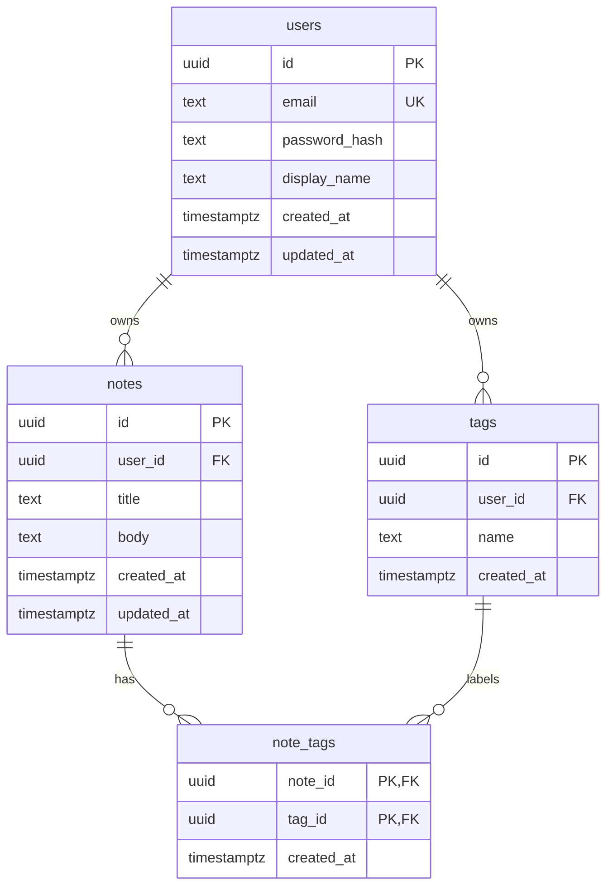

# QuickNotes Data Model

This document defines the PostgreSQL schema behind the API in
[api-design.md](api-design.md). There are four tables: `users`, `notes`, `tags`
and the join table `note_tags`.

## 1. Entity-relationship diagram



## 2. Relationships

| Relationship | Type | How it is modelled |
| --- | --- | --- |
| users → notes | One-to-many | `notes.user_id` is a foreign key to `users.id`. One user has many notes, and each note has exactly one owner. |
| users → tags | One-to-many | `tags.user_id` is a foreign key to `users.id`. Tags are per user: Ada's `work` and Ben's `work` are different rows. |
| notes ↔ tags | Many-to-many | The join table `note_tags` has one row per (note, tag) pair. Its composite primary key `(note_id, tag_id)` stops the same tag being attached to a note twice. |

## 3. Tables

### users

| Column | Type | Constraints | Notes |
| --- | --- | --- | --- |
| `id` | `UUID` | **PK**, default `gen_random_uuid()` | UUIDs cannot be guessed and match the API's ids. |
| `email` | `TEXT` | `NOT NULL`, `UNIQUE`, must be lowercase | Stored lowercased so `Ada@x.com` and `ada@x.com` count as the same email. |
| `password_hash` | `TEXT` | `NOT NULL` | A bcrypt/Argon2 hash. **The plaintext password is never stored.** |
| `display_name` | `TEXT` | `NOT NULL`, 1–50 chars | |
| `created_at` | `TIMESTAMPTZ` | `NOT NULL`, default `now()` | |
| `updated_at` | `TIMESTAMPTZ` | `NOT NULL`, default `now()` | Kept current by a trigger. |

### notes

| Column | Type | Constraints | Notes |
| --- | --- | --- | --- |
| `id` | `UUID` | **PK**, default `gen_random_uuid()` | |
| `user_id` | `UUID` | `NOT NULL`, **FK → users.id** `ON DELETE CASCADE` | Deleting an account deletes that user's notes. |
| `title` | `TEXT` | `NOT NULL`, `CHECK (char_length(title) BETWEEN 1 AND 100)` | Same rule the client and API enforce. |
| `body` | `TEXT` | `NOT NULL`, default `''`, max 20,000 chars | Empty string instead of NULL, so there is one way to mean "no body". |
| `created_at` | `TIMESTAMPTZ` | `NOT NULL`, default `now()` | |
| `updated_at` | `TIMESTAMPTZ` | `NOT NULL`, default `now()` | Kept current by a trigger; used to sort the notes list. |

### tags

| Column | Type | Constraints | Notes |
| --- | --- | --- | --- |
| `id` | `UUID` | **PK**, default `gen_random_uuid()` | |
| `user_id` | `UUID` | `NOT NULL`, **FK → users.id** `ON DELETE CASCADE` | |
| `name` | `TEXT` | `NOT NULL`, 1–30 chars, lowercase, **`UNIQUE (user_id, name)`** | One user cannot have two `work` tags, but different users can. |
| `created_at` | `TIMESTAMPTZ` | `NOT NULL`, default `now()` | |

### note_tags

| Column | Type | Constraints | Notes |
| --- | --- | --- | --- |
| `note_id` | `UUID` | **PK (part 1)**, **FK → notes.id** `ON DELETE CASCADE` | Deleting a note removes its links. |
| `tag_id` | `UUID` | **PK (part 2)**, **FK → tags.id** `ON DELETE CASCADE` | Deleting a tag removes it from all notes. |
| `created_at` | `TIMESTAMPTZ` | `NOT NULL`, default `now()` | When the tag was attached. |

## 4. SQL schema (PostgreSQL 13+)

```sql
-- gen_random_uuid() is built into PostgreSQL 13+ (no extension needed).

CREATE TABLE users (
    id            UUID        PRIMARY KEY DEFAULT gen_random_uuid(),
    email         TEXT        NOT NULL UNIQUE
                              CHECK (email = lower(email) AND position('@' IN email) > 1),
    password_hash TEXT        NOT NULL,
    display_name  TEXT        NOT NULL CHECK (char_length(display_name) BETWEEN 1 AND 50),
    created_at    TIMESTAMPTZ NOT NULL DEFAULT now(),
    updated_at    TIMESTAMPTZ NOT NULL DEFAULT now()
);

CREATE TABLE notes (
    id          UUID        PRIMARY KEY DEFAULT gen_random_uuid(),
    user_id     UUID        NOT NULL REFERENCES users (id) ON DELETE CASCADE,
    title       TEXT        NOT NULL CHECK (char_length(title) BETWEEN 1 AND 100),
    body        TEXT        NOT NULL DEFAULT '' CHECK (char_length(body) <= 20000),
    created_at  TIMESTAMPTZ NOT NULL DEFAULT now(),
    updated_at  TIMESTAMPTZ NOT NULL DEFAULT now()
);

CREATE TABLE tags (
    id          UUID        PRIMARY KEY DEFAULT gen_random_uuid(),
    user_id     UUID        NOT NULL REFERENCES users (id) ON DELETE CASCADE,
    name        TEXT        NOT NULL
                            CHECK (char_length(name) BETWEEN 1 AND 30 AND name = lower(name)),
    created_at  TIMESTAMPTZ NOT NULL DEFAULT now(),
    UNIQUE (user_id, name)
);

CREATE TABLE note_tags (
    note_id     UUID        NOT NULL REFERENCES notes (id) ON DELETE CASCADE,
    tag_id      UUID        NOT NULL REFERENCES tags (id) ON DELETE CASCADE,
    created_at  TIMESTAMPTZ NOT NULL DEFAULT now(),
    PRIMARY KEY (note_id, tag_id)
);

-- DEFAULT now() only applies on INSERT. This trigger keeps updated_at
-- correct on every UPDATE, so application code cannot forget to set it.
CREATE FUNCTION set_updated_at() RETURNS trigger AS $$
BEGIN
    NEW.updated_at := now();
    RETURN NEW;
END;
$$ LANGUAGE plpgsql;

CREATE TRIGGER users_set_updated_at
    BEFORE UPDATE ON users
    FOR EACH ROW EXECUTE FUNCTION set_updated_at();

CREATE TRIGGER notes_set_updated_at
    BEFORE UPDATE ON notes
    FOR EACH ROW EXECUTE FUNCTION set_updated_at();
```

## 5. Indexes

```sql
-- 1. "List my notes, newest first" (GET /notes), the most frequent query.
CREATE INDEX idx_notes_user_updated ON notes (user_id, updated_at DESC);

-- 2. "Notes with tag X" (GET /notes?tag=) and tag counts (GET /tags).
CREATE INDEX idx_note_tags_tag ON note_tags (tag_id);
```

| Index | Query it serves | Why |
| --- | --- | --- |
| `notes (user_id, updated_at DESC)` | `WHERE user_id = $1 ORDER BY updated_at DESC LIMIT 20` | Without it, PostgreSQL scans the whole notes table (hundreds of millions of rows at scale) and then sorts. With it, PostgreSQL jumps straight to this user's notes, which are already stored newest first, and reads only 20 entries. The column order matters: the filter column (`user_id`) comes first and the sort column second. It also covers the plain `WHERE user_id = $1` lookups, so `user_id` needs no separate index. |
| `note_tags (tag_id)` | `JOIN note_tags ON tag_id = $1` | The primary key `(note_id, tag_id)` already speeds up "tags of this note" because `note_id` comes first. It cannot help "notes with this tag", because `tag_id` is the second column. This index covers that direction. |
| `tags UNIQUE (user_id, name)` | `WHERE user_id = $1 AND name = $2` | Created automatically by the UNIQUE constraint. It enforces "no duplicate tag names per user" and makes looking up a tag by name fast. |
| `users UNIQUE (email)` | Login: `WHERE email = $1` | Created automatically by the UNIQUE constraint. |

**Cost of indexes:** each index makes writes slightly slower and uses disk space,
because every INSERT or UPDATE must also update the index. QuickNotes has about
4× more reads than writes (see [architecture.md](architecture.md)), so these two
indexes are worth it. We do not index columns that no query filters on.

## 6. Example queries

`$1`, `$2`, ... are bound parameters. Values are **never** pasted into the SQL
string, which prevents SQL injection.

### 6.1 List a user's notes, newest first (one page)

```sql
-- GET /notes?page=2&limit=20  ->  OFFSET = (page - 1) * limit = 20
SELECT id, title, body, created_at, updated_at
FROM notes
WHERE user_id = $1
ORDER BY updated_at DESC
LIMIT 20 OFFSET 20;

-- Total count for the pagination metadata
SELECT count(*) FROM notes WHERE user_id = $1;
```

### 6.2 A user's notes with their tags (JOIN)

```sql
SELECT n.id,
       n.title,
       n.body,
       n.updated_at,
       COALESCE(
           array_agg(t.name ORDER BY t.name) FILTER (WHERE t.id IS NOT NULL),
           '{}'
       ) AS tags
FROM notes n
LEFT JOIN note_tags nt ON nt.note_id = n.id
LEFT JOIN tags t       ON t.id = nt.tag_id
WHERE n.user_id = $1
GROUP BY n.id
ORDER BY n.updated_at DESC
LIMIT 20;
```

`LEFT JOIN` keeps notes that have no tags (they get an empty array). An `INNER JOIN`
would silently drop them.

### 6.3 Notes filtered by tag (JOIN)

```sql
-- GET /notes?tag=work
SELECT n.id, n.title, n.body, n.updated_at
FROM notes n
JOIN note_tags nt ON nt.note_id = n.id
JOIN tags t       ON t.id = nt.tag_id
WHERE t.user_id = $1
  AND t.name    = $2          -- 'work'
  AND n.user_id = $1          -- ownership check on the note itself
ORDER BY n.updated_at DESC
LIMIT 20;
```

### 6.4 A user's tags with note counts (GET /tags)

```sql
SELECT t.id, t.name, count(nt.note_id) AS note_count
FROM tags t
LEFT JOIN note_tags nt ON nt.tag_id = t.id
WHERE t.user_id = $1
GROUP BY t.id
ORDER BY t.name;
```

### 6.5 Create a note with tags in one transaction (POST /notes)

```sql
BEGIN;

INSERT INTO notes (user_id, title, body)
VALUES ($1, $2, $3)
RETURNING id, title, body, created_at, updated_at;      -- gives :note_id

-- Create any tags that do not exist yet; existing ones are left alone.
INSERT INTO tags (user_id, name)
SELECT $1, unnest($4::text[])                           -- e.g. '{personal,errands}'
ON CONFLICT (user_id, name) DO NOTHING;

INSERT INTO note_tags (note_id, tag_id)
SELECT :note_id, id
FROM tags
WHERE user_id = $1 AND name = ANY ($4::text[]);

COMMIT;
```

If any step fails (for example, the title breaks the CHECK constraint), the whole
transaction rolls back. A note never ends up saved with only half its tags.

### 6.6 Delete a note (DELETE /notes/{id})

```sql
DELETE FROM notes WHERE id = $1 AND user_id = $2;
```

`ON DELETE CASCADE` removes its `note_tags` rows automatically. If 0 rows are
affected, the note doesn't exist **or isn't this user's**, and the API returns
`404` in both cases, as the API design requires.

## 7. Design decisions

- **UUID vs BIGINT identity keys.** UUIDs cannot be guessed (`/notes/1`, `/notes/2`, ...),
  can be generated on any server without coordination, and are what the API
  exposes. The cost is 16 bytes instead of 8 and slightly larger indexes, which
  is acceptable at this scale.
- **Per-user tags.** Tags belong to a user rather than being shared globally, so
  renaming or deleting a tag never affects anyone else. The cost is the same
  name stored many times, but tag names are tiny.
- **Same-owner rule.** A note may only be linked to a tag owned by the same user.
  The API enforces this by always looking tags up with
  `WHERE user_id = <current user>` (see 6.5). It could also be enforced in the
  database with composite foreign keys that include `user_id`. We left that out
  for now to keep the schema easier to read.
- **CASCADE choices.** Deleting a user removes everything they own, which
  supports account deletion and privacy requests. Deleting a note or tag removes
  only the links in `note_tags`, never the other side.
- **Offset pagination.** `LIMIT/OFFSET` is simple and matches the API's
  `?page=`. For very deep pages, keyset pagination
  (`WHERE updated_at < $last_seen`) would be faster. This can change later
  without touching the schema.

## 8. Why SQL (PostgreSQL) instead of NoSQL

QuickNotes data is relational. Users own notes and tags, and notes and tags have
a **many-to-many** relationship, which a join table and JOINs model directly.
PostgreSQL also **enforces integrity itself**: foreign keys prevent orphaned
notes and dangling tag links, `UNIQUE (user_id, name)` prevents duplicate tags,
and `CHECK` keeps titles 1–100 characters even if a bug in the application lets
bad data through. **ACID transactions** let us create a note and its tags as one
operation that either fully succeeds or fully rolls back (6.5). In a document store
such as MongoDB, we would have to choose between copying tag names into every
note (so renaming a tag means updating many documents) or doing the JOINs
ourselves in application code. Filtering and counting by tag also comes free
with SQL. The scale is well within what one PostgreSQL primary with read
replicas can handle: about 58 writes/s at peak and at most about 730 GB/year
(see [architecture.md](architecture.md)).

**When NoSQL would be better:** if notes became large, free-form documents with
nested blocks and no relationships, if writes reached hundreds of thousands per
second and needed automatic horizontal sharding (for example, DynamoDB or
Cassandra partitioned by `user_id`), or if the main need were flexible-schema
or full-text search. Even then, a common pattern is to keep PostgreSQL as the
source of truth and add a specialised store alongside it, such as Elasticsearch
for search, fed by the async worker.
